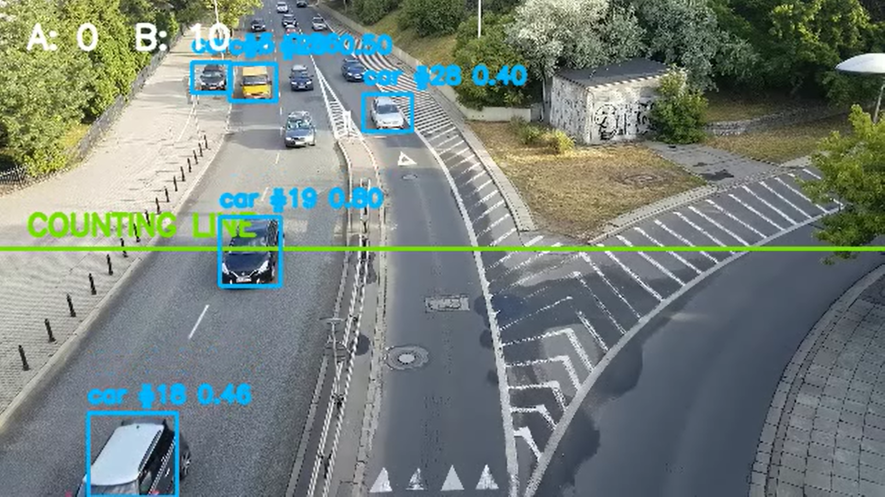

# Vehicle Flow | YOLOv8 + ByteTrack

Detect vehicles. Track movement. Count line crossings. Export the evidence.

A Python computer-vision project for vehicle detection and traffic-flow analysis using YOLOv8, ByteTrack, and OpenCV.

## Demo

[**▶ Watch the annotated demo video**](outputs/sample_fixed/annotated.mp4)



## Sample Results

| Metric | Result |
|---|---:|
| Frames processed | 300 |
| Resolution | 640 × 360 |
| Video frame rate | 30 FPS |
| Crossing events | 14 |
| Cars | 13 |
| Trucks | 1 |

These are observed counts from the included sample run, not model-accuracy measurements.

- [Annotated video](outputs/sample_fixed/annotated.mp4)
- [Crossing events CSV](outputs/sample_fixed/crossing_events.csv)
- [Run summary JSON](outputs/sample_fixed/summary.json)
- [Validation details](docs/validation.md)

## Features

- YOLOv8 vehicle detection
- ByteTrack multi-object tracking
- Virtual line-crossing counts by direction
- Vehicle labels and tracking IDs
- Annotated video output
- CSV events and JSON summaries
- Video-file and webcam input
- Configurable confidence, image size, and line position

## Pipeline

**Video → Detection → Tracking → Line Crossing → Results**

## Stack

Python · Ultralytics YOLOv8 · ByteTrack · OpenCV · NumPy · pytest

## Setup

Requires Python 3.10+ and compatible YOLO model weights.

```bash
git clone https://github.com/abdulfadhil/real-time-vehicle-detection-yolo.git
cd real-time-vehicle-detection-yolo
python -m venv .venv
```

Activate the environment:

**Windows PowerShell**
```powershell
.\.venv\Scripts\Activate.ps1
```

**Linux/macOS**
```bash
source .venv/bin/activate
```

Install dependencies:

```bash
python -m pip install -r requirements.txt
```

## Model

Model weights are not included. Obtain weights you are permitted to use and follow [`models/README.md`](models/README.md).

Example model path: `models/yolov8n.pt`

## Run

Process a video:

```bash
python run.py --source "path/to/video.mp4" --model "models/yolov8n.pt" --imgsz 320 --confidence 0.35
```

Use a webcam:

```bash
python run.py --source 0 --model "models/yolov8n.pt" --display
```

Useful options:

- `--output-dir`: output folder; default `outputs`
- `--imgsz`: inference image size; default `640`
- `--confidence`: confidence threshold; default `0.35`
- `--line-position`: counting-line position from `0` to `1`; default `0.50`
- `--display`: show processed frames; press `q` to stop

Each run generates an annotated video, a crossing-event CSV, and a JSON summary in the output directory.

## Tests

```bash
python -m pytest -q
```

The test suite covers counting logic, runner behaviour, and video input handling.

## Limitations

Counts depend on the footage, detections, tracking, model, and line placement. The sample does not establish precision, recall, F1-score, ground-truth accuracy, or real-time performance. The system counts virtual line crossings; it does not measure calibrated physical traffic density.

## Project Structure

```text
docs/
  assets/vehicle-detection-demo.png
  validation.md
models/README.md
outputs/sample_fixed/
  annotated.mp4
  crossing_events.csv
  summary.json
src/vehicle_flow/
tests/
run.py
requirements.txt
pyproject.toml
LICENSE
README.md
```

## Background

Developed as a team project exploring vehicle detection, tracking, and traffic-flow analytics.

## License

See [`LICENSE`](LICENSE) for the repository's license terms. Third-party libraries and model weights are subject to their own applicable terms.
